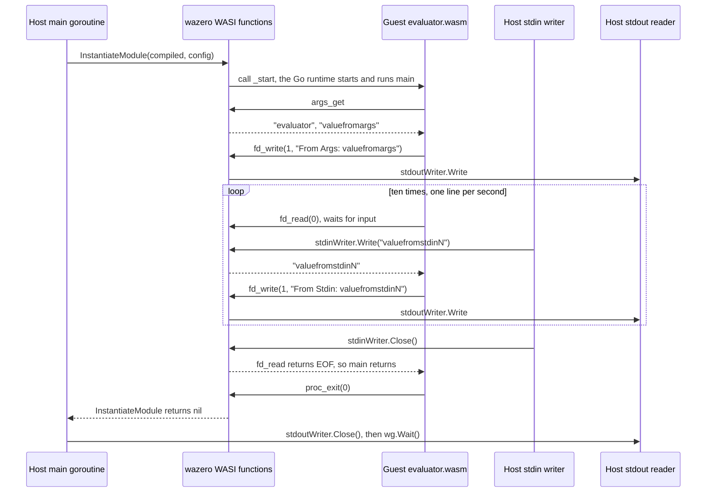

# golang-wazero-example

A small, heavily commented example of running a Go program compiled to WebAssembly inside another Go program, using [wazero](https://wazero.io), a WebAssembly runtime written in pure Go.

- **Host**: [host.go](host.go) is a normal Go program. It loads the guest, passes it a command-line argument, streams ten lines into its stdin (one per second), and prints each line the guest writes to stdout as soon as it appears.
- **Guest**: [evaluator/evaluator.go](evaluator/evaluator.go) is also a normal Go program, compiled with `GOOS=wasip1 GOARCH=wasm` into [evaluator/evaluator.wasm](evaluator/evaluator.wasm).

Both files explain what each step does and why, so you can read them top to bottom like a tutorial. This README gives the big picture and some experiments to try.

> Written in 2023 for Go 1.21, the first release with `GOOS=wasip1` (back then it still needed `gotip`). Updated in November 2026 for Go 1.27 and wazero 1.12.

## Run it

You need Go 1.26 or newer, and nothing else: no gotip, no cgo, no separate WebAssembly runtime. (With Go 1.21 to 1.25, the go command downloads a newer toolchain automatically.)

```bash
go run .
```

You'll see one line per second:

```text
From stdout: From Args: valuefromargs
From stdout: From Stdin: valuefromstdin0
From stdout: From Stdin: valuefromstdin1
...
From stdout: From Stdin: valuefromstdin9
```

Every line made a round trip: the guest wrote `From Args: …` or `From Stdin: …` to its stdout, and the host received it through a pipe and printed it with the `From stdout:` prefix.

## How it works

### One language, two targets

The guest contains no WebAssembly-specific code. It reads `os.Args` and `os.Stdin` and prints with `fmt.Println`, so it also runs natively:

```bash
printf 'a\nb\n' | go run ./evaluator hello
```

What makes it WebAssembly is the build. `GOARCH=wasm` makes the compiler emit WebAssembly bytecode instead of machine code for a physical CPU, and `GOOS=wasip1` makes [WASI](https://wasi.dev) preview 1 its operating system.

### WASI: how sandboxed code does I/O

WebAssembly code can only compute, using numbers and its own block of memory. It can't open a file, print, or read the clock by itself. For that, it calls functions that it imports from the host, and WASI standardizes which functions those are. The compiled guest imports 16 of them from a module named `wasi_snapshot_preview1`:

```text
args_get        args_sizes_get       environ_get     environ_sizes_get
clock_time_get  fd_close             fd_fdstat_get   fd_fdstat_set_flags
fd_prestat_get  fd_prestat_dir_name  fd_read         fd_write
poll_oneoff     proc_exit            random_get      sched_yield
```

It exports two things: `_start`, its entry point, and `memory`. wazero implements all of WASI preview 1 in Go, so whenever the guest touches the outside world, it is calling Go code in the host:

| In the guest | WASI function | In the host |
| --- | --- | --- |
| `os.Args` | `args_sizes_get`, `args_get` | the values passed to `ModuleConfig.WithArgs` |
| reading `os.Stdin` | `fd_read` on file descriptor 0 | `Read` on the `io.Reader` passed to `WithStdin` |
| `fmt.Println` | `fd_write` on file descriptor 1 | `Write` on the `io.Writer` passed to `WithStdout` |
| `main` returns, or `os.Exit(n)` | `proc_exit` | `InstantiateModule` returns |

### The guest gets nothing it isn't given

By default, wazero gives a guest no arguments, no environment variables and no files. Its stdin is always at EOF, its stdout and stderr are thrown away, and its clocks and random numbers are fake and the same on every run. This is what makes it safe to run code you didn't write. It's also why `host.go` has to connect the guest's stdin, stdout and stderr explicitly.

### Streaming with pipes and goroutines

`host.go` connects the guest's stdin and stdout to two [`io.Pipe`](https://pkg.go.dev/io#Pipe)s. A pipe has no buffer: a write waits until a reader has taken the data, and a read waits until there is data to take. That is what lets the two programs talk line by line while the guest is running.

`InstantiateModule` doesn't return until the guest's `main` function has finished. So the host feeds stdin and reads stdout in two other goroutines, at the same time.

While the guest waits for input, it is blocked inside `fd_read`, which is a `Read` on the host's pipe. Go's wasip1 port runs all goroutines on a single thread, so the whole guest is paused and uses no CPU. On an Apple Silicon Mac, a 10-second run uses about 0.4 seconds of CPU, mostly to compile the module.



### How the guest ends

When `main` returns, the Go runtime calls `proc_exit(0)`. wazero treats exit code 0 as success, so `InstantiateModule` returns `nil`. Any other exit code (from `os.Exit(n)`, or `2` after a panic) comes back as a `*sys.ExitError`, and `host.go` prints it as `exit_code: n`.

## Change the guest

`host.go` embeds `evaluator/evaluator.wasm` with `//go:embed`, so after you edit `evaluator/evaluator.go`, rebuild the `.wasm` file:

```bash
go generate
```

That runs the `//go:generate` line in `host.go`, which is equivalent to:

```bash
GOOS=wasip1 GOARCH=wasm go build -trimpath -buildvcs=false -o evaluator/evaluator.wasm ./evaluator
```

`-trimpath` and `-buildvcs=false` keep the absolute paths of your files and the current Git commit out of the binary. With them, rebuilding unchanged code with the same Go version gives a byte-identical `.wasm` file, wherever you build it. The `//go:generate` line uses `env` to set `GOOS` and `GOARCH`. A plain Windows shell has no `env` command, so there you set the two variables and run `go build` yourself.

You can also run the guest without the host, using the wazero CLI:

```bash
printf 'a\nb\n' | go run github.com/tetratelabs/wazero/cmd/wazero@v1.12.0 run evaluator/evaluator.wasm hello
```

## Experiments

Break things on purpose to see why the code is written the way it is. Each experiment is a one-line change. Run `go generate` first if you changed the guest, then `go run .`.

| Change | What happens | Why |
| --- | --- | --- |
| In `host.go`, delete the line `WithStdout(stdoutWriter).` | No output at all | The guest's stdout falls back to wazero's default, which throws everything away. |
| In `host.go`, comment out `defer stdinWriter.Close()` | All ten lines, then `fatal error: all goroutines are asleep - deadlock!` | The guest never sees EOF, so it waits in `fd_read` forever. In the stack trace, the guest's `fd_read` shows up as an ordinary `io.(*pipe).read` in the host. |
| In `host.go`, comment out `stdoutWriter.Close()` in Step 8 | The same deadlock, after the guest has exited | The reader goroutine never sees EOF, so `wg.Wait()` never returns. |
| At the end of the guest's `main`, add `os.Exit(3)` | The output ends with `exit_code: 3` | `proc_exit(3)` reaches the host as a `*sys.ExitError`. |
| At the end of the guest's `main`, add `panic("boom")` | The panic and its stack trace, then `exit_code: 2` | The guest's Go runtime prints the panic to stderr, which the host passes through, and exits with code 2. |

## Where to go next

- **Call functions in the guest.** Since Go 1.24, `go build -buildmode=c-shared` turns a wasip1 program into a WASI reactor. It exports `_initialize` instead of `_start` (in wazero, use `WithStartFunctions("_initialize")`), and it stays alive afterwards, so the host can call functions marked `//go:wasmexport` as often as it likes.
- **Start faster.** [`wazero.NewCompilationCacheWithDir`](https://pkg.go.dev/github.com/tetratelabs/wazero#NewCompilationCacheWithDir) keeps compiled code on disk between runs.
- **Grant more.** `WithSysWalltime`, `WithSysNanotime` and `WithSysNanosleep` give the guest real time, `WithRandSource(rand.Reader)` from `crypto/rand` gives it real randomness, and `WithFSConfig` shares a directory with it.
- **Contain untrusted code.** `wazero.NewRuntimeConfig().WithCloseOnContextDone(true)`, combined with a context deadline, stops a guest that runs too long, and `WithMemoryLimitPages` caps how much memory it can use.

## Keeping it up to date

To update the example again later, or to check your own changes:

```bash
go get github.com/tetratelabs/wazero@latest && go mod tidy
go fix ./...
go vet ./... && GOOS=wasip1 GOARCH=wasm go vet ./evaluator
staticcheck ./... && GOOS=wasip1 GOARCH=wasm staticcheck ./evaluator
go generate && go run .
```

- `go fix` rewrites code to use newer Go features, such as `for i := range 10`.
- The `GOOS=wasip1 GOARCH=wasm` variants check the guest for the platform it is actually built for.
- Update staticcheck whenever you update Go, because older releases can't read the package data of newer Go versions: `go install honnef.co/go/tools/cmd/staticcheck@latest`. With Go 1.27, use staticcheck 2026.2 or newer.
